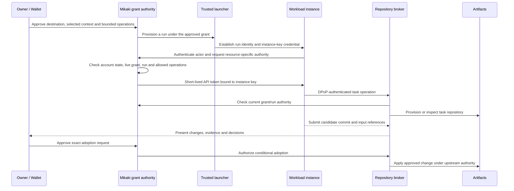

# ADR 0016: Personal context across repositories with bounded workload delegation

**Status:** Accepted product and responsibility direction, 2026-10-06. The [portable Rust domain contract](../workload-profile-v1.md) has been carried onto current main. Earlier D1, Worker, UI and Artifacts qualification is retained in a pre-main snapshot; it does not qualify integration with main's fresh schema. See the [main integration plan](../work-delegation-implementation.md). The full workload wire profile, product ingress, external integration and rollout below remain proposals.

**Research reviewed:** 2026-10-06. This is an architecture decision report and design note, not implementation, interoperability or deployment evidence.

Designer and technical-review findings and their dispositions are recorded in the [design review](../workload-delegation-review.md).

## Context

Mikaki should let a person continue work across repositories and AI agents while keeping their context, decisions and authority under their control. Mikaki's own development will be the first field in which to refine that experience. Moving its canonical repository to Cloudflare Artifacts is a possible later step, after the workflow is exercised.

The product interaction is a work request: choose a goal, select context, identify a destination, delegate bounded operations, compare results and adopt selected outcomes. Adopting an outcome can update code or record a decision for future work; these are separate effects with separate approvals.

Cloudflare's [Git platform proposal](https://blog.cloudflare.com/next-git-platform-on-cloudflare/) motivates using Artifacts for versioned code and agent context. The [Workers binding](https://developers.cloudflare.com/artifacts/api/workers-binding/) provides repository creation, import, fork, inspection and Git-token management. These primitives can support the workflow, but do not define Mikaki's human consent or workload trust model.

The existing [architecture](../architecture.md) already separates human authentication, application authorization, encrypted owner data and delegated agent access. [ADR 0012](0012-vault-protocol-boundaries.md) separates credential presentation from storage and AI adapters. This decision extends those responsibility boundaries into repository work; it does not replace the existing owner data contracts.

## Accepted product and responsibility principles

1. Make continuity of a person's work across projects and agents the product goal. Use Mikaki development as the first practical use case.
2. Minimize information that requires Wallet/Vault custody: identity credentials and sensitive identity evidence, personal access credentials, and protected key material or references. Put ordinary work context and versioned results in repositories under an explicit visibility policy. Existing encrypted names and notes retain their current storage and recovery contracts until a separate migration is designed.
3. Keep human identity, workload identity, the running instance and delegated authorization distinct. A workload proves its own identity and receives bounded authority derived from a human-approved grant.
4. Keep one authoritative lifecycle for each grant, run, approval and side effect across frontend, HTTP and MCP adapters. Resolve implementation ownership under existing ADRs before adding endpoints.

## Proposed architecture and protocol selection

1. Compose established standards for the workload profile: OAuth Token Exchange for delegation, DPoP for supported HTTP access, and RAR for structured human authorization. Evaluate SPIFFE credentials for workload authentication and federation. SPIFFE compatibility requires the selected specification's issuance and verification rules, not just a URI with a `spiffe` scheme.
2. Use Artifacts as the first repository-backend candidate. Mikaki owns the mapping from a live grant and authenticated workload to repository/API operations. Agents write to task repositories; a separate authorized operation adopts changes into the upstream repository.
3. Evaluate bounded delegation using an ABAC decision model and an AuthZEN-shaped internal interface. Introduce the AuthZEN HTTP API when independently deployed enforcement points need a qualified shared decision service. This retains the existing [OpenID/OAuth priorities](../oidc-standards-priorities.md), rather than requiring an external PDP for simple owner checks.

These are implementation proposals with qualification gates. The accepted principles do not select a workload assertion format, external policy engine, deployment topology or canonical-repository migration date.

## Data placement and visibility

| Data | Intended home | Visibility and authority |
| --- | --- | --- |
| Personal preferences, selected conversations, project decisions and reference material | Versioned context repositories | Owner chooses repository visibility and what each work request discloses. Ordinary context need not require a Vault unlock. |
| Identity credential, disclosures and sensitive identity evidence | Wallet/Vault compartment | Present only the requested evidence to the intended verifier. Keep issuer proof and holder binding intact. |
| Personal API credentials and protected signing keys | Qualified device custody or encrypted secret storage | Use through an approved operation or credential protocol. A non-exportable device key can remain in a Keystore, with only its reference stored elsewhere. |
| Public verification keys, schema and disclosure-safe policy documents | Repositories or authenticated public metadata | Verification uses a trusted binding to the owner/issuer and an approved policy revision. Publication alone does not establish trust. |
| Work request manifest, selected context versions, candidate commits and publishable approval receipts | Task/context repositories | Record the relationship between the request, inputs and adopted output without embedding access tokens or sensitive presentations. |
| Grant revisions, revocation, runs, replay state and credential-issuance/revocation work | Authoritative Mikaki service state | Enforce current authorization and record operational outcomes. Git history is not the live revocation ledger. |

### Service operational credential custody

Implementation refinement, 2026-10-07: distinguish a person's identity/API credentials from credentials the service creates solely to prepare, verify, mediate and clean up a work repository. Keep the former in their qualified Wallet/Vault/device boundary. Assign the latter to a named service custody boundary, with private encrypted restart state where needed and a versioned service-key recovery contract. Neither belongs in the context repository or ordinary owner projection.

Service revocation and outstanding allocation/token reconciliation must remain possible after owner logout, account/source revocation or unavailable Vault keys. New copying/delegation still requires current owner consent and authorization. This does not authorize releasing credentials to a workload or migrating personal secrets to service custody. The portable core binds encrypted service credentials to their exact preparation, attempt, repository, token observation and wrapping-key generation. The retained pre-main implementation additionally qualified private custody, candidate retention, independent checkpointing and one-time initial repository creation with safety-only token reconciliation through a separate attenuating broker. Their [main integration gates](../work-delegation-implementation.md#main-integration-order) remain open. Upload/readback and other productive effects require separate admission. Signed deployment provenance, service key/storage provisioning, retention/export and broader productive release/restore fencing remain distinct gates; no production placement is activated.

### Personal, project and request context

Personal context has an owner-controlled source independent of any destination project; a private, owner-managed context repository can be that source without requiring Vault custody. Project context belongs to a named project. Request context records only the versions selected for this work and their disclosure destinations. A project/task fork must not become the implicit canonical home of the person's cross-project preferences.

Sharing selects versions from those sources into a request snapshot. The frontend shows the actual files and reachable history exposed to each recipient, including repositories, operators and execution platforms that receive a copy. Selection of one version does not authorize future revisions automatically. The owner can reuse a prior selection for another agent after reviewing the new recipient and acquiring a new grant/run credential.

Handoff includes selected input versions, adopted decisions, unresolved questions and explicitly selected prior results. Prior secrets are not transferred. Unadopted suggestions remain visibly proposals and are included only when selected, never silently promoted into personal or project context.

"Outside Vault" does not mean "public". Private repositories still disclose data to their operator and authorized readers; Git readers may obtain history as well as current files. A context selection must cover every object and history actually made available, not just the frontend's displayed files. Build a dedicated snapshot repository when only selected material may be shared; do not assume a full fork narrows read access.

Public keys can correlate activity across projects. Prefer purpose- or recipient-specific keys where correlation is unwanted. A hash of predictable personal information is not automatically safe to publish. Credential presentations may reveal selected attributes even when undisclosed attributes remain hidden. [W3C VC privacy considerations](https://www.w3.org/TR/vc-data-model-2.0/#identifier-based-correlation) and [SD-JWT](https://www.rfc-editor.org/rfc/rfc9901.html) describe these limits.

Already delivered context, repository clones and disclosed claims cannot be recalled by revoking a grant. Retention and deletion cover copies controlled by the service; externally held copies and backups have separate limits.

This placement is a target, not a description of today's entire service. Current linked-card attributes also have plaintext OP storage, and current Agent snapshots/private drafts have their own disclosure boundaries. See [architecture](../architecture.md) and [identity implementation](../identity-card-issuance.md) before making any custody claim.

## Identity and trust model

| Entity | Meaning |
| --- | --- |
| Owner | The person who authorizes the work, represented to each resource with an appropriate subject identifier. |
| OAuth client | Registered software participating in a protocol. Its client ID does not identify a particular running agent. |
| Logical agent/workload | A registered software role within a trusted issuer's domain. Provider/model labels are descriptive metadata unless independently verified. |
| Workload instance/run | A particular execution, with its own run ID and key binding. Multiple instances can implement the same logical workload. |
| Delegation grant | A live owner decision about destination, disclosed inputs, operations, deadline and permitted actor. |

A trusted launcher or execution platform must bind the instance's public key to the run and issue or attest the workload credential. Proving possession of a self-generated key establishes possession only; it does not establish the launcher, provider or runtime. Human approval of a key establishes the owner's consent to that key, not execution-platform attestation. If a remote platform cannot provide trusted evidence, document the actual weaker registration boundary rather than assigning it the same assurance.

Present owner-enrolled keys/clients and execution-platform-verified workloads as different assurance modes. The first managed-run slice qualifies the latter; an owner-enrolled external-agent path needs its own allowed operations and enrollment evidence, not a universal requirement that every user supply platform attestation.

Accepting an SVID authenticates its SPIFFE ID under configured trust-domain rules. Mikaki must separately map that ID to an enrolled logical workload and verify the instance/run/key/grant association. Do not assume that an X.509-SVID inherently contains a Mikaki run ID.

Repository verification keys must be anchored through authenticated owner registration, an already trusted key or a trusted issuer. An agent-editable key or policy file cannot authorize that agent's own privileges. Key replacement, issuer/trust-bundle changes and recovery require their own authorized transitions.

Keep login/Passkey, credential-holder, workload and service-signing keys separate. WebAuthn credentials do not offer a generic API for signing arbitrary JWTs. A WebAuthn approval ceremony can bind a server-held request digest to its challenge; a credential presentation uses its qualified holder-key path. [ADR 0012](0012-vault-protocol-boundaries.md) and the [credential protocol review](../vault-protocol-review.md) retain those boundaries.

Authentication proves the credential's asserted execution identity within its trust model. It does not prove that a particular model was used, that the program remained uncompromised or that its reasoning is correct. Claims about code/runtime provenance require separately verified evidence.

## Standards and adoption posture

The following status is a research snapshot as of 2026-10-06; check newer revisions before implementing a draft-dependent profile.

| Standard or specification | Maturity reviewed | Proposed role and limit |
| --- | --- | --- |
| [SPIFFE and SVID](https://spiffe.io/docs/latest/spiffe/concepts/) | Established open workload-identity specifications | Identify a workload within a trust domain. Select X.509-SVID or JWT-SVID according to transport and custody needs; JWT-SVID alone is not a DPoP-bound token. |
| [SPIRE](https://spiffe.io/docs/latest/spire-about/spire-concepts/) | Implementation of SPIFFE issuance and attestation | Candidate for managed execution environments. Its node/workload attestation explains why an issuer trusts a workload; no SPIRE deployment is selected here. |
| [OAuth Token Exchange, RFC 8693](https://www.rfc-editor.org/rfc/rfc8693.html) | Standards Track RFC | Authenticate the actor and exchange a grant-related subject token for resource-specific authority. Supports actor claims and delegation history; grant policy and revocation propagation remain implementation responsibilities. |
| [DPoP, RFC 9449](https://www.rfc-editor.org/rfc/rfc9449.html) | Standards Track RFC | Bind supported HTTP access tokens to a proof key. Does not identify an unregistered workload or provide general request-body/commit integrity. |
| [RAR, RFC 9396](https://www.rfc-editor.org/rfc/rfc9396.html) | Standards Track RFC | Describe structured requested rights during owner authorization. Repository/actions/context semantics require a documented Mikaki type and participating-client support. |
| [AuthZEN Authorization API 1.0](https://openid.net/specs/authorization-api-1_0.html) | OpenID Final, published 2026-01-11 | Standard decision-query interface. Use its information model internally first; policy semantics, attribute trust and live enforcement belong to the [Mikaki authorization profile](../workload-authorization.md). |
| [ABAC, NIST SP 800-162](https://csrc.nist.gov/pubs/sp/800/162/upd2/final), and [attribute guidance, SP 800-205](https://csrc.nist.gov/pubs/sp/800/205/final) | Published NIST guidance | Attribute-based decision method and attribute-management considerations, not a token or wire protocol. Proposed rules can further restrict a grant but cannot manufacture owner consent. |
| [JWT access-token profile, RFC 9068](https://www.rfc-editor.org/rfc/rfc9068.html) | Standards Track RFC | Candidate format for Mikaki-issued API tokens. It does not turn a JWT into a workload-attestation credential. |
| [OpenID4VP 1.0](https://openid.net/specs/openid-4-verifiable-presentations-1_0.html) and [SD-JWT, RFC 9901](https://www.rfc-editor.org/rfc/rfc9901.html) | Final OpenID presentation protocol and Standards Track RFC respectively | Wallet evidence when a requested identity attribute is needed. A presentation is not continuing repository/API authority; the SD-JWT credential profile has its own version/maturity. |
| [WIMSE architecture, draft-ietf-wimse-arch-08](https://datatracker.ietf.org/doc/draft-ietf-wimse-arch/08/) | Active WG Internet-Draft | Reference architecture for workload identity and security context across execution systems. |
| [AIMS, draft-ietf-wimse-aims-00](https://datatracker.ietf.org/doc/draft-ietf-wimse-aims/00/) | WG Internet-Draft, published 2026-09-15, intended Informational | Agent-oriented composition of workload identity, OAuth and related mechanisms. This supersedes the earlier `draft-klrc-aiagent-auth`; it is not a finalized agent protocol. |
| [ID-JAG, draft-ietf-oauth-identity-assertion-authz-grant-04](https://datatracker.ietf.org/doc/draft-ietf-oauth-identity-assertion-authz-grant/04/) | Active OAuth WG Internet-Draft | Later cross-application access where a resource AS trusts the person's IdP. Trust relationships and downstream support are prerequisites; not required for the first managed-run slice. |
| [MCP roadmap](https://modelcontextprotocol.io/development/roadmap#3-agent-identity-and-enterprise-ready-security) | Roadmap, not a completed interoperability profile | Tracks DPoP, Workload Identity Federation, ID-JAG and Token Exchange for agent access and delegation. Probe actual target clients independently. |

Start with an explicitly documented issuer-signed workload assertion from a controlled launcher, plus a resource-bound delegated API profile. Keep the workload-credential verifier replaceable so independently issued SPIFFE credentials can be accepted after a qualified trust/transport profile is chosen. Do not call the initial assertion an SVID without implementing the applicable SPIFFE specification.

### Delegated token semantics

For a proposed JWT delegation profile, the conceptual claims are:

| Claim or server binding | Intended meaning |
| --- | --- |
| `iss` | Mikaki authority that issued this token; not the workload's self-assertion. |
| `sub` | The owner on whose behalf the operation is authorized, with recipient-appropriate identification. |
| `act.sub` | The authenticated acting workload/instance identity; represented as `act: { "sub": "..." }` in a JWT. |
| `aud` | The exact intended resource, such as Mikaki's repository broker. |
| `cnf.jkt` | Confirmation binding on the Mikaki-issued access token: the instance proof-key thumbprint when DPoP is required. |
| `exp`, `jti` | Bounded lifetime and token identifier. |
| Grant/run association | Server-owned link to grant ID/revision, run, destination and allowed operations. Any additional wire claims are Mikaki profile fields. |

This is a semantic map, not a complete wire schema or an existing endpoint contract. The subject input to exchange represents an approved delegation; do not pass a personal login token or Wallet private key to the workload. The AS must verify the actor, permitted exchange, subject/actor binding and requested destination.

The first profile must separately define authentication of the OAuth client making the exchange request and validation of the acting workload. Specify the client mode/authentication method, accepted `actor_token` type, issuer/audience/subject/key/run checks, and `may_act` or equivalent server policy limiting who can exchange the subject token. A client ID or PKCE exchange alone does not establish workload identity. The existing preregistered public-client Agent OAuth profile is not implicitly extended by this proposal.

RAR describes owner authorization. This ADR does not assume that arbitrary `authorization_details` are a standard RFC 8693 request parameter. Pin the authorization-request type and define how granted details constrain subsequent exchanges and resource enforcement.

If subdelegation is enabled later, child operations and destinations must remain within the parent's effective grant, expiry cannot exceed the parent, and the parent/run association must remain authoritative. Nested `act` claims can preserve history; that history is not proof that a child has a particular right. Do not enable subdelegation in the first slice.

## Policy decisions with AuthZEN and ABAC

OAuth establishes delegated token authority; a resource's enforcement point still checks whether the current actor may perform this operation now. The proposed [workload authorization profile](../workload-authorization.md) models the acting instance as subject, a named operation as action, an immutable or revision-bound target as resource, and verified owner/grant/run/environment data as context.

For delegated workload operations, grant scope is an upper bound. Current account, run, policy, disclosure and approval predicates can narrow it. Owner adoption is evaluated under current owner/target authority and fresh exact approval, independently of reactivating the producing run. A PDP allow result supplies neither an encryption key nor a new grant and cannot replace a guarded domain transition. Start with internal decision vectors over authoritative records; qualify a remote AuthZEN PDP only when policy sharing requires it. Keep policy and grant ownership singular.

## Frontend review and control requirements

The supporting [work-request UI design](../work-request-ui.md) maps these requirements to logical views, state/failure behavior and prototype acceptance scenarios. Current evidence covers requirements review, not a clickable repository-work interface.

Before delegation, show the goal, recipient and assurance mode, actual disclosed inputs/versions/history, destination and result repository, permitted operations and deadline. Summarize selected versions, history boundaries and recipients, with expandable details; do not obscure broader access behind a file list. Translate the operation profile into user-facing effects; protocol claim names belong in diagnostics.

Show decisions with safe reasons and available next steps: select the required context, approve a new destination or issue a fresh grant. Resource previews and denial reasons must not reveal resources the caller cannot discover. Policy diagnostics distinguish an ordinary refusal from a temporary decision-service failure.

Expose code adoption and saving a decision for future context as separately selectable effects. A candidate can be accepted as code without making its explanation long-term context; a saved decision need not mutate code. Each effect binds its reviewed target, value and scope.

Revoking a producer's delegation does not prevent the owner from reviewing retained results and approving a new exact adoption under current owner/target authority. That fresh owner operation does not restore the producer's grant. A pending approval invalidated by a relevant authority change still requires new review.

The activity view distinguishes running work, revoked authority, external credential cleanup still pending, already dispatched effects and previously disclosed copies. Stopping delegation prevents newly authorized work; stopping an execution is a separate launcher operation with its own confirmed outcome. Do not label all of those states simply "cancelled".

## Proposed work-request flow

The diagram shows logical responsibilities, not a deployment topology. A direct Git token, if released under the profile below, is a separate bearer-credential path.

The request manifest binds the owner, grant revision, run, destination, upstream base commit, selected context object/commit digests, operations and absolute expiry. Treat context content as untrusted input, including instructions embedded in documents. Readable instructions cannot expand the grant.

The review view connects the candidate commit to the request and source versions and presents tests and agent explanations with their provenance. An explanation from an agent is its assertion; a test result verified by an independent runner has a different source.

Adoption approval binds the exact candidate, expected upstream state, operation and expiry. Reject changed candidates, stale bases or changed authority relevant to that approval; require a new review when the proposed effect changes. Record the producing grant/run and their state as provenance. A fresh owner adoption can authorize a retained candidate after producer revocation without restoring the old run or reusing an invalidated approval. Review of code does not approve deployment, and adopting a written decision does not approve a repository mutation.

## Artifacts authorization boundary

The [Artifacts authentication contract](https://developers.cloudflare.com/artifacts/guides/authentication/) separates Worker bindings, control-plane API tokens and repo-scoped Git tokens. The Git token profile grants repository-level `read` or `write`; it does not advertise path/ref restrictions or DPoP binding. A Mikaki proof cannot be presented directly as that Git credential.

The proposed first slice gives agents write authority only for their task repositories. The upstream write credential stays with the adoption operation. Forking, token issuance and upstream adoption must use an internal destination mapping authorized by Mikaki, not arbitrary client-supplied namespace/repository names. Keep the namespace binding behind bounded service operations.

There are two execution paths to qualify:

| Path | Enforcement and consequence |
| --- | --- |
| Broker performs repository operations | Mikaki can check the instance proof and live grant before each supported operation. Git transport/proxy support, if needed, must be separately demonstrated. |
| Broker releases a short-lived Artifacts token for normal Git | Scope is the task repository, and possession of that bearer token allows its Git operations until expiry/revocation. DPoP protects the issuance request, not subsequent direct Git use. |

The binding's `createToken`, `listTokens` and `revokeToken` operations are candidates for a credential lifecycle. Qualification must establish how every issued credential is identified and revoked, including lost responses and restart. Initial credentials returned by repository creation/fork/import also need managed revocation; do not leave an untracked credential active. See the [binding API](https://developers.cloudflare.com/artifacts/api/workers-binding/).

The lost-response probe must establish whether initial credentials can be recovered as revocable IDs/metadata. If they cannot, stop provisioning and define cleanup/recreation only for a disposable task repository that has not been released to a recipient or received unique work. Establish current emptiness from Git refs/content and tracked effects; stage 0 observed that `last_push_at` stayed null after a verified push, so it is not sufficient evidence. Do not delete an upstream or populated repository as a generic token-recovery action. Measure the actual effect/latency of revocation as well as expiry.

Mikaki database transactions and Artifacts mutations are not one atomic transaction. Use a durable issuance/revocation state machine with reconciliation: stop new authority on revocation, retain protected revocation handles, retry external cleanup, and expose incomplete outcomes to operators. Choose and measure the maximum usable interval for outstanding direct Git tokens. Do not claim immediate revocation or sender-constrained Git access from the DPoP API profile.

## Authority, failure and lifecycle

Owner authentication remains with the Rust OP. Existing Agent grant/proposal/OAuth operations remain under [ADR 0013](0013-agent-proposal-authority.md) and [ADR 0014](0014-agent-oauth-authority.md). Their bounded TypeScript exceptions do not automatically extend to workload issuance, Token Exchange or repository adoption.

The [first implementation profile](../workload-profile-v1.md#component-ownership) assigns portable rules to `mikaki-auth::work` and durable transitions/audit to Rust OP `work_store`, under [ADR 0009](0009-rust-oidc-and-worker-stack.md). Thin Cloudflare-binding adapters handle platform calls without becoming a second grant authority. Preserve [ADR 0015](0015-service-data-ownership.md): downstream services receive bounded capabilities, not arbitrary OP D1/R2 access. New service interfaces and their qualification remain explicit implementation decisions.

For the proposed workload profile:

- Authenticate the owner independently of workload enrollment. An identity credential or key-possession proof does not itself grant repo access.
- Check fresh authoritative grant/run/account state for exchanges and broker operations. Expiry cannot extend the parent grant. Restart or key replacement must not silently regain revoked authority.
- Revocation stops newly authorized exchanges and broker effects and schedules cleanup of derived external credentials. [RFC 8693](https://www.rfc-editor.org/rfc/rfc8693.html#section-2.1) does not supply automatic parent-to-child revocation linkage.
- A mutation's authorization and audit intent must commit under live guards before external dispatch. Revocation rejects work that has not crossed the defined dispatch boundary; an already dispatched or externally accepted effect may finish. Define that boundary and reconcile its outcome rather than promising cancellation of in-flight effects.
- Bind mutation retries to the same caller, request and exact effect. After an ambiguous response, resolve the committed outcome before repeating it. Never report success solely from frontend state.
- Separate owner logout, delegation revocation, workload stop, credential expiry and repository retention. Present those controls according to the actual effect each has.
- Audit actor, owner reference, grant/run revision, operation, target, outcome and time. Keep access tokens, private keys, credential presentations and context bodies out of routine audit logs.
- Enforce resource/cost quotas in the service/runtime. A signed purpose or deadline does not enforce a compute budget or prevent an authorized recipient from retaining plaintext.

External API credentials whose provider does not support proof-based access require a separate authorized credential-use adapter. That adapter must restrict destination and operation; personal API keys are not generic workload-proof credentials.

## Alternatives and consequences

| Alternative | Assessment |
| --- | --- |
| Shared personal credentials for every agent | Easy integration, but obscures the acting instance and makes selective revocation difficult. Does not meet the decision's identity/authority separation. |
| One permanent service account per agent product | Useful logical identity, but insufficient for instance attribution, selected input versions and per-request authority. May remain the launcher/provider identity. |
| Require SPIRE throughout the first deployment | Strong managed-environment issuance pattern, but execution-host access, attestors and transport support are not yet selected. Qualify the initial controlled-launcher path first. |
| Use Wallet credentials as the ongoing API grant | Useful for requested identity evidence; does not define continuing repo rights, live revocation or child authority. Keep presentation and delegation separate. |
| Implement a complete agent-specific identity protocol | AIMS and the MCP roadmap support composing existing mechanisms. Document the remaining Mikaki profile semantics rather than claiming a new universal standard. |
| Make repository policy files the live authorization ledger | Useful portable descriptions, but mutable files and replicated history cannot replace the authoritative grant and revocation lifecycle. |

Benefits are continuity across tools, explicit disclosure, attributable runs and review tied to the inputs used. Costs include credential lifecycle state, trusted launcher integration, external mutation reconciliation and client-specific interoperability. Workload authentication improves attribution within a trust model; it does not certify the quality or safety of an agent's output.

## Implementation sequence and acceptance gates

| Stage | Concrete outcome and required evidence |
| --- | --- |
| 0. Establish an Artifacts development copy | Before the two-agent work trial, qualify bootstrap token identification/cleanup on a disposable repository, then import a selected committed Mikaki baseline into a development namespace. Record the source commit and imported contents/history. Keep the current canonical remote authoritative and refresh the baseline in one controlled direction; isolate experimental runs in task repositories. This bootstrap copy does not establish workload interoperability or change the canonical write destination. |
| 1. Freeze the first profile | Define launch trust, identifiers, key custody, OAuth requester authentication, actor assertion type/trust and permitted exchange, resource audience, RAR type and live grant checks. Define the attribute/action vocabulary and decision vectors from the [authorization proposal](../workload-authorization.md). Select the transition owner. Explicitly disable subdelegation. |
| 2. Complete one bounded run | Owner approves selected non-sensitive context; a controlled launcher creates an instance; that instance obtains broker authority and submits a candidate. Exercise untrusted issuer, substituted actor/key, wrong audience, expired/revoked grant, replay and audit/DB failure. |
| 3. Compare and hand off real work | Run two independent agents from the same code/context baseline on one Mikaki task. Show separate run identities and results. Review disclosed history and assurance modes; hand off adopted decisions, open questions and selected prior results without inheriting old secrets or silently adopting proposals. |
| 4. Adopt an exact result | Independently verify candidate/evidence provenance; approve an exact effect; test stale upstream, substituted candidate, revocation races, concurrent retries and ambiguous external outcomes. |
| 5. Qualify external credentials and clients | Demonstrate Git-token scope, expiry, initial-token identification/cleanup after crash/lost response, measured revocation delay, and destination isolation. Probe actual CLI/MCP clients. Add SPIFFE, remote AuthZEN or cross-application federation only with a named need and independent issuer/PDP/client evidence. |
| 6. Consider a canonical repository migration | Use evidence from the development copy and real work trials. Reproduce required CI/release checks, qualify adoption/mirroring and rehearse rollback before changing the canonical remote. Define a single authoritative write direction. |

The first success criterion is practical continuity: another agent can continue the next day with the selected decisions and constraints intact, while acquiring only its own authorized run credentials. Workload proof and human approval must remain distinguishable in the recorded outcome.

Stage 0 completed on 2026-10-06: the selected Artifacts development baseline was independently cloned and verified, issued Git credentials were revoked, and the disposable empty probe was deleted. Selected input, API/Git evidence and remaining qualification limits are recorded in the [Artifacts development-copy runbook](../artifacts-development-copy.md). This does not complete the later workload/delegation or canonical-migration stages.

The [implementation backlog](../work-delegation-implementation.md) refines these stages into profile/ownership decisions, one managed request-to-adoption loop, stop/recovery and handoff qualification, and a parallel CI lane. It sequences a single-result adoption before expanding to two-agent comparison; this is an implementation ordering proposal, not completion of these rollout gates or an accepted new protocol/placement decision.

## Open decisions

- Which execution environments are controlled by Mikaki, and what trusted enrollment/attestation can external agent platforms provide?
- What are the identifier, key-rotation and recovery contracts for logical workloads versus instances?
- What are the initial RAR type, supported client fallback, exchange input profile and maximum lifetimes? A fallback must preserve server-enforced target/operation restrictions.
- Which PEPs need shared decisions, what are trusted attribute sources and revision/freshness rules, and which policy engine or remote PDP can satisfy the [authorization proposal](../workload-authorization.md)?
- Which runtime owns workload and repository transitions, and which bounded service interfaces satisfy the existing language/storage ADRs?
- Which Git operations require a broker, and which can accept a direct task-repository bearer token? What revocation interval is acceptable and demonstrable?
- What context belongs to the person, project or individual request, and how are disclosure history, retention and decision adoption presented?
- When should SPIFFE federation, ID-JAG and subdelegation be added, based on a named external issuer/client use case?

## Current evidence

The [Agent OAuth profile](../agent-oauth.md), [approved encrypted commits](../vault-approved-commit.md), [Wallet/identity implementation](../identity-card-issuance.md) and [service ownership](0015-service-data-ownership.md) provide local implementation evidence for adjacent boundaries. They do not qualify this workload profile, a repo broker or an Artifacts integration. Current production scope remains recorded in [status](../status.md).

This decision adds documentation only. No workload issuer, Token Exchange endpoint, DPoP agent profile, repository integration, storage migration or deployment is implemented by this report.
