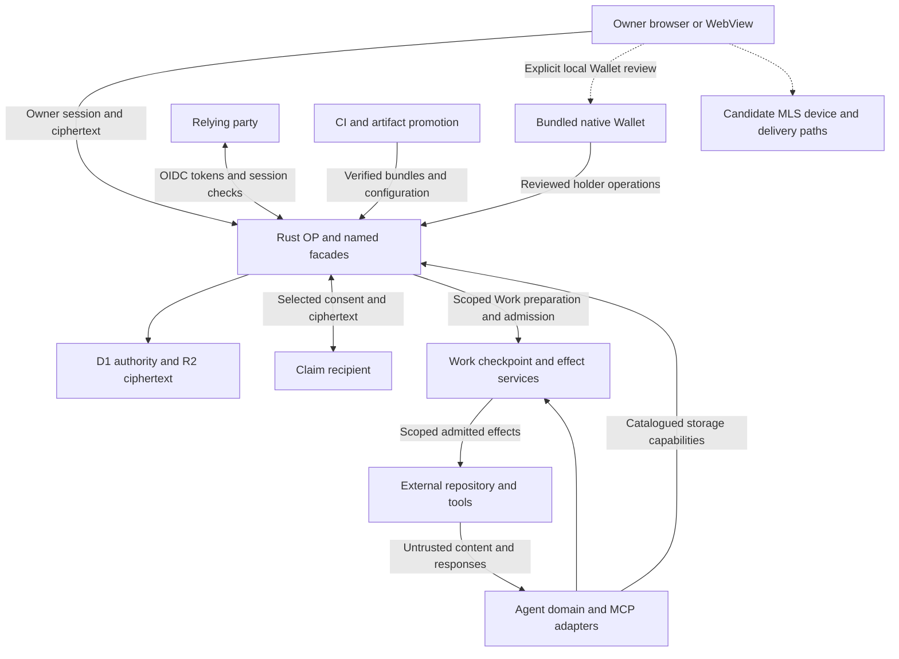

# Mikaki security threat model

Protect account authority, encrypted owner data, Identity/Wallet credentials, and delegated work from unauthorized access or effects. This initial model accompanies the [security assurance plan](security-assurance-plan.md) and the revision-specific [verification inventory](security-verification-inventory.md).

## Assets and attacker capabilities

| Asset | Security property | Relevant attacker |
| --- | --- | --- |
| Account, Passkeys, OP/RP sessions and token state | Correct subject and purpose binding; single use; bounded authority after revocation. | Unauthenticated caller, malicious owner B, malicious registered RP, holder of a stolen session/token. |
| Vault root/content keys, PRF outputs and record plaintext | Authorized local decryption, integrity and context binding; explicit selected disclosure. | Malicious record/import content, compromised page script, stale device, compromised recipient. |
| Identity intake, credentials and holder keys | Bounded retention, explicit release, verified issuer/device trust and holder possession. | Forged attester, malicious verifier, unauthorized owner, remote WebView content. |
| Work grants, checkpoints, tokens and external effects | Exact scoped consent, no authority expansion, durable replay prevention and recoverable unknown outcomes. | Malicious agent, repository content or tool response; stale/compromised worker. |
| Build/deploy credentials, artifacts, bindings and migrations | Trusted source-to-runtime promotion and minimum deployment authority. | Untrusted PR contributor, compromised dependency/action, substituted artifact/configuration. |
| Candidate MLS device identities, keys and group state | Verified enrollment and continuity, removal/rejoin rules, rollback resistance and authorized delivery. | Malicious peer/directory/relay, revoked device, replayed or conflicting registry/checkpoint data. |

Review provider compromise and a fully compromised owner endpoint as residual-risk cases. A page script that can run inside an unlocked owner context can reach plaintext; key nonextractability alone cannot prevent that exposure. Revocation governs future access and effects; it cannot erase plaintext or keys already copied by an authorized recipient.

## Trust boundaries

The [architecture](architecture.md) and [implementation authority map](implementation-authorities.md) define the current source responsibilities. Candidate MLS paths are identified separately below.

1. **Browser to OP:** Cookies establish owner sessions; PRF decryption authority remains separate. Validate CSRF/origin, object ownership, body bounds, and session lifecycle on each applicable operation.
2. **OP to RP:** The RP validates issuer, audience, state, nonce, signatures and PKCE, and owns its local session. A successful OP login does not grant arbitrary application roles.
3. **OP to storage/recipient/agent:** Named bindings carry explicit authority. Review allowed operations, query catalogs, parameter ownership, plaintext release and recipient key custody.
4. **Owner to Work and external effects:** Consent binds the concrete data, source, destination and operation. Revocation, final admission, unknown results and independent checkpoints must agree across restarts and restore.
5. **Remote content to privileged operations:** Messages, imports, repositories and tool results are data. Instructions inside them cannot change capability, approval or destination decisions.
6. **WebView to native Wallet:** Remote documents have no general IPC capability. Navigation/callback data must not skip bundled review or choose arbitrary native commands, origins or key aliases.
7. **Source to deployed runtime:** The reviewed revision, generated bytes, migrations, configuration, bindings and active version require linked evidence.
8. **Candidate MLS device to registry/group/delivery:** Session-bound enrollment, device-key possession, independently confirmed fingerprints and monotonic continuity state jointly determine authority.

## Required invariants

| ID | Invariant |
| --- | --- |
| INV-01 | Authority comes from a validated session or explicitly scoped capability; caller-supplied identifiers never establish ownership or administration. |
| INV-02 | Credential, challenge, code, token and proof validation preserve exact subject, client, origin, audience, purpose, key and request binding as applicable. |
| INV-03 | Single-use state and security revisions are checked at the committing authority; concurrent requests cannot create two admissions. |
| INV-04 | Revocation and expiry remain effective across retries, delayed responses, restarts and restoration under the documented recovery contract. |
| INV-05 | PRF output and root/holder keys stay in their custody domain; authorized disclosure releases only the exact selected content. |
| INV-06 | Ciphertext, wraps and operations bind their identity, generation and revision fields; tampering or substitution cannot silently change the protected context. |
| INV-07 | External effects match an exact admitted operation; an unknown outcome does not authorize blind replay or wider authority. |
| INV-08 | Untrusted content cannot select privileged commands or expand consent, capability, source or destination. |
| INV-09 | Inputs, cryptographic parsing and retained state have resource bounds; errors, logs and artifacts do not reveal protected material. |
| INV-10 | An activated release and profile can be traced to reviewed source, verified bytes/configuration and the separately exercised environment. |

## Priority attack scenarios

All twenty scenarios initially have execution status `planned`. Priority P0 is the first assessment batch; P1 follows it before the scoped assessment closes. Test references identify related starting points, whose assertions and environment must be reviewed before recording scenario coverage.

| ID | Priority | Attacker action | Required outcome and evidence | Starting point |
| --- | --- | --- | --- | --- |
| SEC-01 | P0 | Owner B substitutes A's record/workspace IDs in reads, writes, lists, exports and deletes. | INV-01/05: no A data or durable change; compare responses and storage before/after across both identities. | [Owner records](../local/conformance/vault-owner-record-store.test.ts) |
| SEC-02 | P0 | An unprivileged caller reaches public/raw OP administration, changes an internal capability ID or supplies another owner's parameters. | INV-01: named facade and catalog restrictions deny the operation without mutation. Test public and internal surfaces separately. | [Service boundaries](../local/conformance/service-boundaries.test.ts), [Work OP boundaries](../local/conformance/work-op-boundaries.test.ts) |
| SEC-03 | P0 | Parallel callers finish the same ceremony or exchange the same authorization code, including a lost response. | INV-02/03: single use and the profile's reuse behavior hold at the product store; retain all responses and durable counts. | [Ceremony contract](webauthn-ceremony-contract.md), [OIDC store](oidc-store-contract.md), [OIDC SQL tests](../scripts/test_oidc_sql.test.ts) |
| SEC-04 | P0 | A malicious RP mixes clients, browser transactions, callback origins, state, nonce or PKCE verifier. | INV-02: no attacker-bound OP/RP session or token issuance. Exercise the actual Worker and supported native callback paths. | [Native OIDC](../local/conformance/native-oidc.test.ts), [Login flow](oidc-login-flow.md) |
| SEC-05 | P0 | A stolen token/proof is replayed or rebound to another key, URL, method, audience or token hash. | INV-02/03: applicable DPoP/JWT checks and durable replay state reject it across Worker reloads. | [DPoP Worker](../local/conformance/dpop-worker.test.ts) |
| SEC-06 | P0 | A late callback, cached lease or lost logout delivery competes with session/client/key revocation. | INV-03/04: revocation and bounded lease behavior follow the contract; delivery failure cannot restore authority. | [Session check](../local/conformance/session-check.test.ts), [Logout queue](../local/conformance/logout-queue.test.ts) |
| SEC-07 | P0 | Vault unlock completes after lock, session replacement, credential rejection or lease expiry. | INV-04/05: late PRF/decrypt results cannot revive the owner lease or render plaintext. Test browser lifecycle as well as pure crypto. | [Owner key](../local/conformance/vault-owner-key.test.ts), [Key browser](../local/conformance/vault-owner-key-browser.test.ts) |
| SEC-08 | P0 | A caller substitutes a ciphertext/wrap, owner, origin, vault, generation or record revision. | INV-05/06: context binding rejects substitution and preserves existing records; valid independent vectors still decrypt. | [Owner key](../local/conformance/vault-owner-key.test.ts), [Record store](../local/conformance/vault-owner-record-store.test.ts) |
| SEC-09 | P0 | A recipient/agent widens selected disclosure, changes approved content, or reuses an expired/revoked grant. | INV-01/04/05: only the exact permitted snapshot is released/committed; record the final authority and audit decision. | [Owner disclosure](../local/conformance/vault-owner-disclosure.test.ts), [Agent grants](../local/conformance/agent-record-grants.test.ts), [Record approval](../local/conformance/vault-record-approval.test.ts) |
| SEC-10 | P0 | Repository/document/tool content asks the agent to bypass review, change destination or invoke privileged administration. | INV-07/08: the broker denies unauthorized effects independently of the model response. Verify the issued authority and actual effect inventory. | [Work credentials](../local/conformance/work-credential-custody.test.ts), [Candidate payload](../local/conformance/work-candidate-payload.test.ts) |
| SEC-11 | P0 | Revoke/freeze/expiry occurs between Work preparation, final admission and remote I/O. | INV-03/04/07: enforce the documented linearization point and permitted reconciliation; no newly unauthorized admission. | [Effect gate](../local/conformance/work-effect-gate.test.ts), [Mint gate](../local/conformance/work-mint-gate.test.ts) |
| SEC-12 | P0 | A lost effect/mint acknowledgment, restart or restored D1 state is used to repeat an external operation. | INV-04/07: retain uncertainty, inspect the same operation identity and checkpoint, and prevent duplicate admission. | [Checkpoint](../local/conformance/work-authority-checkpoint.test.ts), [Mint recovery](../local/conformance/work-mint-recovery.test.ts), [Effect gate](../local/conformance/work-effect-gate.test.ts) |
| SEC-13 | P0 | A remote page or forged native callback tries to invoke Wallet IPC, choose a key, or skip consent. | INV-01/05/08: only the allowed navigation/callback path reaches bundled review; no unapproved signature or release occurs. | [Native boundary](tauri-client-auth.md), [Identity presentation](../local/conformance/identity-presentation.test.ts) |
| SEC-14 | P1 | A false attester/issuer, revoked chain or substituted verifier requests Identity release. | INV-02/04/05: configured trust and exact consent/holder binding apply; feature-disabled and unconfigured trust paths deny release. | [Identity attester](../local/conformance/identity-attester.test.ts), [Revocation](../local/conformance/identity-revocation.test.ts), [Issuance](../local/conformance/identity-issuance.test.ts) |
| SEC-15 | P0 | Candidate MLS enrollment/replacement uses owner B, a directory-supplied confirmation, revoked generation or substituted fingerprint. | INV-01/02/04/06: reject the binding or retain required peer review; replacement approval cannot authorize the old group member. Test default and enabled candidate profiles. | Candidate-only sources listed in the [inventory](security-verification-inventory.md#candidate-wallet-and-chat-scope). |
| SEC-16 | P0 | A candidate MLS client receives stale/conflicting witness state, a restored journal, duplicate delivery or reordered cancellation/rejoin. | INV-03/04/06: enforce continuity and recovery rules across fresh browser contexts and server restart; retain conflict evidence. | Candidate-only persistence, recovery and replacement suites in the [inventory](security-verification-inventory.md#candidate-wallet-and-chat-scope). |
| SEC-17 | P1 | Imported records/messages carry active markup or links intended to execute script or exfiltrate unlocked plaintext. | INV-05/08/09: rendering, navigation, CSP and connection policy enforce the approved content contract. Inspect DOM, requests and synthetic plaintext canaries. | [Owner workspace browser](../local/conformance/vault-owner-workspace-browser.test.ts), [Typed attributes](vault-typed-attributes.md) |
| SEC-18 | P1 | A caller submits malformed/deep/oversized JSON, CBOR, DER, JWT, archive or allowed request bursts. | INV-09: bounded resource use and defined rejection; no panic or protected-data leakage. For user-controlled fetch destinations, test approved hosts and redirect rules with a local sink. | [WebAuthn fuzzing](webauthn-fuzzing.md), [Auth resources](../local/conformance/auth-resources.test.ts), [Git host boundaries](../local/conformance/work-git-host-boundaries.test.ts) |
| SEC-19 | P0 | A PR, dependency/action or substituted release artifact/configuration tries to acquire deployment authority or change promoted bytes. | INV-08/10: permissions, trusted producer identity, source/digest checks and environment controls reject substitution. Use offline fixtures and an isolated promotion rehearsal. | [Release inventory tests](../scripts/release-inventory.test.ts), [Deployment tests](../scripts/deploy-production.test.ts), [Release runbook](release-and-recovery.md) |
| SEC-20 | P1 | A failure, debug trace, browser artifact, retained intake or restored backup exposes secrets or resurrects deleted authority. | INV-04/05/09/10: retention, redaction and recovery generation meet the domain contract. Inspect synthetic canaries and restored disposable state. | [Auth resources](../local/conformance/auth-resources.test.ts), [Vault GC](../local/conformance/vault-gc.test.ts), [Identity issuance](identity-card-issuance.md), [Release runbook](release-and-recovery.md) |

For each execution, retain the immutable revision, scenario and invariant IDs, enabled profile, identities, validation method, expected result, actual result, and durable effect comparison. Broaden browser checks to the supported engines and record physical-device gates explicitly. Keep confirmations and replay ledgers independent of attacker-controlled test inputs.
