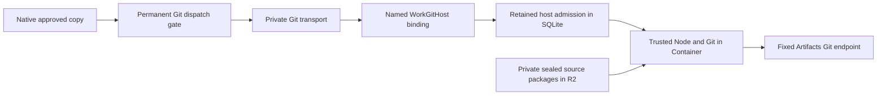

# Private Git host and sealed source registration

Status: development implementation, with local Native/Git/R2/SQLite and Linux
image qualification. Cloudflare deployment and real Artifacts qualification
remain separate. The [isolated infrastructure lane](work-git-host-qualification.md)
checks startup/R2 supply with Internet and productive Git disabled, through a
private operator service binding. This supplies the host/provisioning component required by
[copy orchestration](work-copy-orchestration.md) and the
[fixed Git gate](work-artifacts-git-gate.md).

## Runtime and trust

Use Cloudflare Containers for the trusted Node/Git program. Workers alone cannot
run its Git child processes. The new Worker uses the
[Durable Object Container API](https://developers.cloudflare.com/containers/api/durable-object-container/)
directly, with the installed Wrangler 4.148.0, generated binding types and
compatibility date 2026-10-10. The configuration uses the documented
[Durable Object scheduling policy](https://developers.cloudflare.com/containers/configuration/scheduling-policy/).
No new runtime SDK dependency is required.



Native and the independent checkpoint/effect journals still own productive
authority, credentials and verification. Host admission is an additional
delivery fence; a package, image, disclosure digest or successful startup grants
no permission. The only caller binding is the existing Git transport's
`GIT_EXECUTOR`, selecting the named `WorkGitHost` entrypoint. The default Worker
handler returns 404, including when enabled; Workers.dev and preview URLs are
disabled. Container ports have no public route.

The host processes trusted fixed Git operations on untrusted Git data. It does
not run repository code, checkout hooks, agent commands or a generic shell.
Provider credentials pass only through the private request's Authorization
header and the existing fixed HTTPS Git exchange. They enter neither R2,
SQLite, the image, command arguments nor request logs. JavaScript strings do not
provide guaranteed memory erasure; these remain trusted secret-bearing components.

## Operator preparation

The [materializer](../scripts/work-git-registry.ts) consumes an exact Native
disclosure **record**, taken from authenticated
`GET /work/disclosures/<digest>`, plus explicitly configured local source
capabilities. It requires `current_sources: true`, matching source and access
revisions, and the closed version-2 manifest. Authenticating that Native export
is the trusted operator's responsibility; the file is not an owner authority
token or a signed attestation. Native repeats current authority at execution.

An operator source file has only these fields:

```json
[
  {
    "source_id": "code",
    "source_revision": 1,
    "access_revision": 1,
    "gitDir": "/trusted/sources/code.git"
  }
]
```

Include exactly the registered sources in the selected disclosure. This local
tool accepts no remote URL or credential. It inspects the exact code commit's
reachable history, independently verifies its Git objects, counts and history
digest, selects the reviewed context blobs, and builds the deterministic
parentless snapshot. Blob mode, bytes, SHA-256, snapshot paths and Native's
planned commit/tree must all match. Wrong revisions, missing contents, source
aliases, changed history or a different planned snapshot cannot register.

```sh
npm run prepare:work-git-host -- NATIVE_RECORD.json OPERATOR_SOURCES.json EXISTING_IGNORED_OUTPUT_DIRECTORY
```

The output contains `registry.json`, `task.pack`, `snapshot.pack`, an
`image-receipt.json`, and an `image/` build context. The receipt pins registry,
program and Dockerfile SHA-256. The image context contains only the bundled
trusted program and Dockerfile: source data stays out of image layers. Use that
generated context when building the image, never the repository root. The base
Node image is digest-pinned and the Docker build targets `linux/amd64`.

Store the three source files in a separately selected **private** R2 bucket,
under `registry/<registry_sha256>/registry.json`, `task.pack` and `snapshot.pack`.
The publisher must retain the selected package pin; changing an object at that
key cannot pass startup hashing. These files contain the selected disclosure,
including context text. Provisioning/upload requires the owner's applicable
disclosure permission and the operator's private-source handling policy. This
tool performs local preparation only, and uploads nothing automatically.

## Cold start and delivery fencing

The [Worker](../crates/work-git-host-worker/worker.ts) fixes the account,
namespace, authority, disclosure and package pin in configuration. It routes to
one stable Durable Object name derived from the configured authority and
disclosure, across image rollouts. Its immutable frame pins those configuration
values. Four permanent role/purpose slots admit at most one task upload,
task readback, snapshot upload and snapshot readback. Admission is synchronized
before container or provider I/O. Duplicate attempts, fresh IDs for the same
slot, lost replies and runtime restart cannot forward another productive call.
Slots and their frame cannot be updated or deleted.

Containers have
[ephemeral filesystems](https://developers.cloudflare.com/containers/concepts/architecture/).
The code-only Linux image initially serves `/health`; `/ready` returns 503.
The Worker reads the pinned R2 registry, streams only its two fixed packs through
the private provisioning port and requests activation. This transport carries
source data without a provider credential. A changed digest, size or pack is
rejected. There is no caller-selected object key, registry path or source URL.

[Activation](../scripts/work-git-host-bootstrap.ts) rebuilds fresh bare object
databases, with bounded pack preflight, strict Git indexing, independently
hashed object inventory, exact reachable counts/commit/tree and full fsck.
Snapshot requires exactly one parentless commit; extra unreachable objects are
refused. Only then does readiness return the exact registry/disclosure pin.
An already activated process cannot be reprovisioned. A running older image or
mismatching ready pin stops the call rather than changing an in-flight host.

The productive port POST is sent once. The Linux listener also consumes each
role/purpose slot once per process, covering duplicate TCP delivery; durable
host admission and the upstream permanent Git gate cover process restart.
Failures retain an unknown outcome. A later caller cannot infer successful
copying from readiness, populated refs or an empty token inventory. Native's
independent full readback and all six credential closures remain required.

## Bounds, retention and deployment

The configuration starts `standard-1`, keeps one process per configured
disclosure and uses a 60-second inactivity timeout. Metadata is bounded to
4 KiB, each sealed pack to 64 MiB, reachable objects to 65,536 and code history
to 4,096 commits. Existing Git pack inflation bounds, operation deadlines,
fixed TLS endpoint and no-redirect/no-retry rules remain intact. Readiness
connection attempts have a 20-second startup bound; provisioning and the single
productive call have bounded timeouts. Actual source size and cold-start/whole
operation latency need qualification on Cloudflare; the small fixture is not a
capacity or latency claim. See [instance limits](https://developers.cloudflare.com/containers/platform/limits/).

The Linux image is qualified locally with a 1 GiB memory cap and one CPU.
Worker logs/traces and Container logs are enabled; request headers, contents and
raw Git errors are not logged. R2 package retention belongs to source-data
operations, separately from image retention and credential closure. Container
shutdown removes its process; neither shutdown nor credential revocation proves
erasure of a delivered copy or its R2 package. Do not use package deletion,
namespace replacement or host-slot resets to retry an uncertain effect.

Before remote activation:

1. Select and verify the staging account, enrolled Native/checkpoint release,
   existing private R2 bucket, separate host Worker and exact immutable image.
2. Provision an owner-authorized, non-sensitive development disclosure from its
   actual registered sources; independently retain package/image receipts.
3. Replace every selector in the [example configuration](../crates/work-git-host-worker/wrangler.example.jsonc),
   keeping `WORK_GIT_HOST_ENABLED=false` until provisioning is checked. Set the
   generated Dockerfile/build-context paths and bind the existing private bucket.
4. Package the Worker with `wrangler deploy --dry-run`. The local
   `--containers-rollout none` dry run checks Worker/configuration only; the
   explicit Docker lane checks the image. Neither qualifies remote resources.
5. Bind the Git transport's `GIT_EXECUTOR` to the named `WorkGitHost`, qualify
   actual Container startup/private ingress/R2 supply, then the admitted Git
   exchange and cleanup. Preserve the fixed account and independent journals.
6. Reconcile the six protected development allocations before selecting a real
   Artifacts trial. Unknown allocations and missing token IDs remain obligations;
   they must not be adopted, replaced or reminted for this host qualification.

Productive Native/copy/Workflow flags, baseline migrations and production
bindings are unchanged. The example does not enable Artifacts copying or
issuer/launcher delegation. Real dev activation requires the existing approval,
active wrapping key, all independent gates and separately qualified resources.

## Qualification commands

```sh
npm run check:work-git-host
npm run test:work-git-host
npm run test:work-git-host-image
```

The default preparation lane includes registry, private R2, SQLite/restart and
sealed-host Workflow/Git tests. Main/PR CI also runs the explicit Docker lane.
The SQLite test uses the actual production admission functions with a synthetic
Linux-port reply; R2 tests use real local R2 and a loopback private port. The
Docker test runs the bundled entry and real Linux Git indexing. Cloudflare
Container scheduling/TCP routing, remote R2 and real Artifacts remain remote
qualification gates. Selected source and final checks are recorded in the
[implementation ledger](work-delegation-implementation.md).
